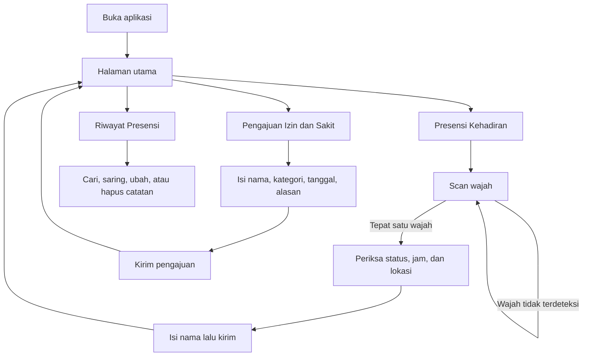

# Presensi Digital XI RPL

Aplikasi presensi untuk siswa kelas XI Rekayasa Perangkat Lunak di IDN Boarding School Solo. Siswa mencatat kehadiran sendiri dengan scan wajah dan lokasi, mengajukan izin atau sakit, dan melihat riwayat presensi kelas. Aplikasi bisa dibuka dari HP maupun dari browser di laptop.

## Untuk siapa

- Siswa XI RPL, untuk check-in setiap hari dan mengajukan izin saat tidak bisa hadir.
- Wali kelas atau pengurus kelas, untuk memantau, mencari, dan merapikan catatan presensi.

## Fitur

### Presensi kehadiran

Siswa mengambil foto wajah lewat kamera depan HP atau webcam laptop. Foto baru diterima kalau di dalamnya ada tepat satu wajah. Kalau wajah tidak terlihat atau ada orang lain ikut masuk bingkai, siswa diminta mengulang.

Saat presensi, aplikasi juga mencatat:

- Lokasi siswa. Di HP tampil sebagai alamat, di laptop sebagai koordinat.
- Hari, tanggal, dan jam presensi.
- Status kehadiran, yang ditentukan otomatis dari jam check-in.

| Jam check-in | Status |
| --- | --- |
| Sampai pukul 08:30 | Tepat Waktu (Attend) |
| 08:31 sampai 17:59 | Terlambat (Late) |
| Mulai 18:00 | Di luar jam operasional (Leave) |

### Pengajuan izin dan sakit

Formulir untuk siswa yang tidak bisa hadir. Isinya nama, kategori (Sakit, Izin, atau Lainnya), tanggal mulai dan selesai, serta alasan yang boleh dikosongkan. Pengajuan tersimpan dan langsung muncul di riwayat presensi.

### Riwayat presensi

Daftar semua catatan kehadiran dan izin, diperbarui langsung tanpa perlu memuat ulang halaman. Di halaman ini pengguna bisa:

- Mencari catatan berdasarkan nama siswa.
- Menyaring catatan per status: Semua, Attend, Late, Izin, atau Sakit.
- Mengubah catatan yang salah, misalnya nama atau keterangan.
- Menghapus catatan. Aplikasi meminta konfirmasi dulu karena data yang dihapus tidak bisa dikembalikan.

## Alur penggunaan

### Check-in harian

1. Buka aplikasi. Halaman utama menampilkan salam, tanggal hari ini, dan batas jam tepat waktu.
2. Pilih Presensi Kehadiran.
3. Tekan Ambil Foto Selfie. Izinkan akses kamera kalau HP atau browser memintanya.
4. Posisikan wajah di dalam oval, lalu tekan Jepret & Verifikasi.
5. Periksa status, jam, dan lokasi yang tampil. Izinkan akses lokasi kalau diminta.
6. Isi nama lengkap, lalu tekan Kirim Presensi Kehadiran.

### Mengajukan izin atau sakit

1. Dari halaman utama, pilih Pengajuan Izin & Sakit.
2. Isi nama, pilih kategori, lalu tentukan tanggal mulai dan selesai.
3. Tulis alasan kalau perlu, lalu tekan Kirim Pengajuan Izin.

### Melihat riwayat

1. Dari halaman utama, pilih Riwayat Presensi.
2. Ketik nama di kolom pencarian atau pilih salah satu status untuk menyaring.
3. Gunakan tombol ubah atau hapus pada catatan yang ingin dirapikan.

## Yang perlu disiapkan

- Kamera: kamera depan di HP atau webcam di laptop.
- Izin kamera dan izin lokasi diberikan saat aplikasi memintanya.
- Koneksi internet, untuk menyimpan presensi dan, di laptop, untuk memuat pemeriksaan wajah.
- Di laptop, gunakan Google Chrome atau Microsoft Edge.
